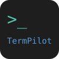

<p align="center">
  
</p>

<h1 align="center">TermPilot</h1>

<p align="center">
  <strong>Control your computer's terminal from your phone.</strong><br>
  Real shells, voice commands, multiple tabs, tmux mirroring, and access from anywhere.
</p>

<p align="center">
  <a href="https://www.npmjs.com/package/@abhishekreddy31/term-pilot"></a>
  <a href="https://github.com/Abhishekreddy31/TermPilot/actions/workflows/ci.yml"></a>
  
  
</p>

<p align="center">
  <a href="#quick-start">Quick start</a> •
  <a href="#features">Features</a> •
  <a href="#reaching-it-from-your-phone">Access</a> •
  <a href="#security">Security</a> •
  <a href="#platform-support">Platforms</a> •
  <a href="#development">Development</a>
</p>

---

## Why TermPilot?

You start a deployment, a long build or a migration, then step away. Did it finish? Is it waiting for a `y`?
Or you are on the couch and need to restart a service while the laptop is across the room.

TermPilot puts that computer's terminal on your phone with one command:

- **A real terminal**, not a log viewer: vim, htop and interactive prompts all work.
- **Sessions that survive**: lock the phone, lose Wi-Fi or reload the page, and your shells (and whatever they are running) are still there.
- **Speak instead of type**: say "git commit dash m fix" and review `git commit -m fix` before sending.
- **Mirror what is already running**: attach to the tmux sessions on your computer and see exactly what it shows.
- **Access from anywhere** with `--tunnel`: a free HTTPS URL through Cloudflare, no account needed.
- **Nothing to deploy**: no server, no sign-up, no subscription. It runs on your computer and in your phone's browser.

## Quick start

```bash
npx @abhishekreddy31/term-pilot           # run once
npm install -g @abhishekreddy31/term-pilot # or install it
term-pilot --tunnel                        # with a public HTTPS URL
```

Sign in as `admin` with the password from `~/.termpilot/credentials` (a new one is generated on every start
unless you set `TERMPILOT_PASSWORD`).

## Features

| | |
|---|---|
| **Sessions** | Open as many shells as you like as tabs. They belong to your login, not to the browser tab: reconnecting or reloading gives them back with their recent output. |
| **Mirror mode** | Attach to existing tmux sessions on the computer. Typing on either side shows on both. Detaching (or losing the connection) leaves the tmux session running. |
| **Extra keys** | Esc, Tab, arrows, PgUp/PgDn and common symbols. **Ctrl** and **Alt** arm for the next key, whether you tap it on the bar or type it on the phone keyboard, so Ctrl+C, Ctrl+D, Alt+B and Ctrl+arrow all work. |
| **Voice** | Speak a command, check the transcription, then send it. See [voice grammar](#voice-commands). |
| **Touch** | Swipe to scroll 5,000 lines of scrollback. |
| **PWA** | Add it to the home screen for a full-screen app. Updates install themselves. |

## Reaching it from your phone

TermPilot listens on `127.0.0.1` by default, so nothing on the network can reach it until you choose how:

| Option | Command | Notes |
|---|---|---|
| **Tunnel** (recommended) | `term-pilot --tunnel` | HTTPS URL that works from anywhere. Needs [`cloudflared`](https://developers.cloudflare.com/cloudflare-one/connections/connect-networks/downloads/) (`brew install cloudflared`, `winget install --id Cloudflare.cloudflared`). |
| **Same Wi-Fi** | `term-pilot --host 0.0.0.0` | Prints the computer's network addresses. Plain HTTP, so traffic is visible to the network, and browsers disable voice input on non-HTTPS pages. |
| **Your own domain / proxy** | `term-pilot --allowed-hosts term.example.com` | Requests are only accepted for known hostnames (see [Security](#security)); add yours. A leading dot allows subdomains: `.example.com`. |

## How it works

```
Phone (browser / PWA)                      Your computer
┌────────────────────┐                     ┌────────────────────────────────┐
│ xterm.js terminal  │◄─── WebSocket ─────►│ Node.js server                 │
│ extra keys, voice  │   (JSON, deflate)   │  ├─ session registry           │
│ tabs, login        │                     │  │   ├─ shells (node-pty)      │
└────────────────────┘                     │  │   └─ tmux clients (mirror)  │
          ▲                                │  ├─ auth (scrypt, tokens)      │
          │ optional                       │  └─ static PWA                 │
   Cloudflare quick tunnel (HTTPS) ───────►│      127.0.0.1                 │
                                           └────────────────────────────────┘
```

1. The phone signs in over HTTPS/HTTP and receives a login token.
2. It opens a WebSocket and sends the token as the first message (never in the URL).
3. Shells are pseudo-terminals spawned by the server. Output streams to every device attached to them, and the
   last 100 KB are kept so a reconnecting device can redraw.
4. If the phone falls behind (slow mobile link), the shell is paused until it catches up, so server memory stays
   bounded even for commands like `cat` on a huge file.

### Session lifetime

- A **shell** lives until it exits, you close its tab, or you have no valid login left: logins expire after
  30 minutes without a connected device or 8 hours in total. Logging out of one device keeps your shells as long as
  another device is still logged in.
- A **mirror tab** is a tmux client for one connection. It is detached when the connection ends (an orphaned client
  would keep the tmux window at the phone's size); the tmux session itself is never touched.

## Security

| Layer | Protection |
|---|---|
| Network | Binds to `127.0.0.1` unless you choose otherwise. The tunnel connects over loopback. |
| Host check | Requests (HTTP and WebSocket) are only accepted for this machine's own names and addresses, the tunnel hostname and `--allowed-hosts`. This stops DNS-rebinding attacks from web pages you visit. Browser `Origin` headers are checked against the same list. |
| Passwords | scrypt (N=16384) with a per-user salt; timing-safe comparison; the same work is done for unknown users. |
| Logins | 256-bit random tokens, server-side, 30-minute idle and 8-hour absolute expiry. Expired logins are disconnected. |
| CSRF | Token required on login and logout. |
| Rate limits | Login: 5 failed attempts per 15 minutes per client, counted as they start (parallel guesses included); successful sign-ins do not count. WebSocket auth: 10 failed attempts per minute. Behind the tunnel the client is identified by Cloudflare's `CF-Connecting-IP`, trusted only from loopback. |
| Authorization | Shells are visible only to the user who created them; tmux clients only to their connection. |
| Input | Every WebSocket message is validated with Zod; frame size and connection count are capped. |
| Shell environment | Shells receive an allowlist of variables (`HOME`, `PATH`, locale, `SSH_AUTH_SOCK`, …), so secrets in the server's environment do not leak into them. |
| Headers | Strict CSP, `frame-ancestors 'none'`, `X-Frame-Options: DENY`, `nosniff`, `no-referrer`, COOP/CORP. |

Anyone who signs in gets a shell as the user running TermPilot. Treat the password like an SSH key.

## Voice commands

The transcript is turned into a command and shown for review before it is sent.

| You say | You get |
|---|---|
| git commit dash m hello | `git commit -m hello` |
| git push double dash force | `git push --force` |
| ls pipe grep test | `ls \| grep test` |
| cd tilde slash projects | `cd ~/projects` |
| cd dot dot slash src | `cd ../src` |
| cat readme dot md | `cat readme.md` |
| git add dot | `git add .` |
| ssh deploy at sign example dot com | `ssh deploy@example.com` |
| echo quote hello world quote | `echo "hello world"` |
| pseudo apt install node | `sudo apt install node` |

Path and file symbols (`dot`, `slash`, `colon`, `at sign`, `equals`, `underscore`) join the words around them, but
never onto the command itself (`cat slash etc` → `cat /etc`). Say **space** to keep two parts apart:
"ls dash la space dot" → `ls -la .`. Voice needs HTTPS (use `--tunnel`) or localhost.

## CLI

```
term-pilot [options]

  -p, --port <port>          Port to listen on (default: 3000; the next 10 are tried if busy)
      --host <address>       Address to bind (default: 127.0.0.1). Use 0.0.0.0 for the local network.
      --tunnel               Expose a public HTTPS URL through Cloudflare Tunnel
      --allowed-hosts <list> Extra hostnames the server may be reached by, comma separated
  -h, --help                 Show help
  -v, --version              Show the version

Environment: PORT, HOST, TUNNEL=1, TERMPILOT_ALLOWED_HOSTS, TERMPILOT_PASSWORD, TERMPILOT_DEBUG=1 (connection log)
```

## Platform support

| | Shells | Mirror mode | Tunnel | Tested in CI |
|---|---|---|---|---|
| macOS (arm64, x64) | `$SHELL` | tmux | yes | arm64 |
| Linux (x64, arm64) | `$SHELL` | tmux | yes | x64 |
| Windows (x64, arm64) | PowerShell | tmux inside WSL | yes | x64, except mirror mode (CI runners have no WSL) |

On every OS, CI runs the unit and integration tests on Node 22, 24 and 26 (the test tooling needs 22+), and
installs the packed npm package and runs the end-to-end tests on Node 20, 22 and 24.

Every architecture listed has a prebuilt terminal binary; CI runs on the ones shown.

Node.js 20 or newer. Installing needs no compiler on the platforms above (other platforms, such as Alpine
Linux, compile the terminal module and need build tools).
On Windows, mirror mode needs `wsl --install` and then `wsl sudo apt install tmux`.

## Development

```bash
git clone https://github.com/Abhishekreddy31/TermPilot.git
cd TermPilot
pnpm install        # pnpm version is pinned in package.json (use corepack)
pnpm dev            # server and client with reload
pnpm run check      # lint, typecheck, unit and integration tests
pnpm run test:e2e   # builds, packs and installs the package, then drives it in mobile Chrome and Safari
```

Development needs Node 22.12 or newer (the published package supports Node 20).

```
packages/
  shared/   protocol types (dependency-free, used by the browser) and Zod schemas (server)
  server/   HTTP + WebSocket server, PTY and tmux management, auth, tunnel, CLI
  client/   Preact + xterm.js PWA
tests/
  unit/         shared, server and client units (client components run in happy-dom)
  integration/  a real server with real shells and an isolated tmux server
  e2e/          the packed npm package, installed and driven by Playwright on emulated phones
scripts/build-publish.js   builds dist/ for npm
```

Tests never touch your own tmux sessions: each test file gets a private tmux server.

### Releasing

1. Bump `version` in `package.json` on `main`.
2. Push a tag `v<version>`.
3. The release workflow runs the full CI matrix, then publishes the exact tarball it tested to npm with
   provenance, using npm trusted publishing (no stored token), and creates the GitHub release.

## Contributing

Issues and pull requests are welcome. Please add tests with your change and make sure `pnpm run check` and
`pnpm run test:e2e` pass.

## License

MIT, see [LICENSE](LICENSE).
